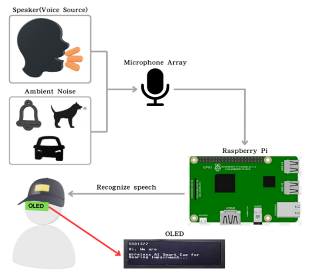
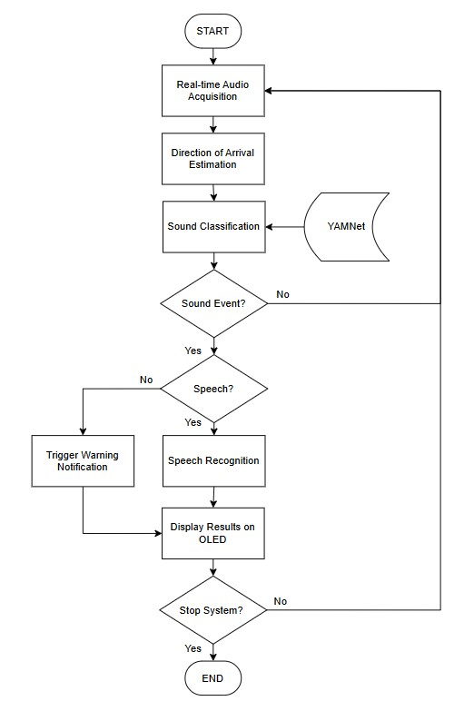
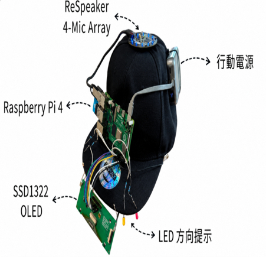
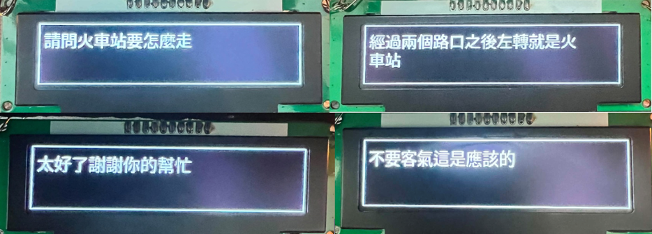
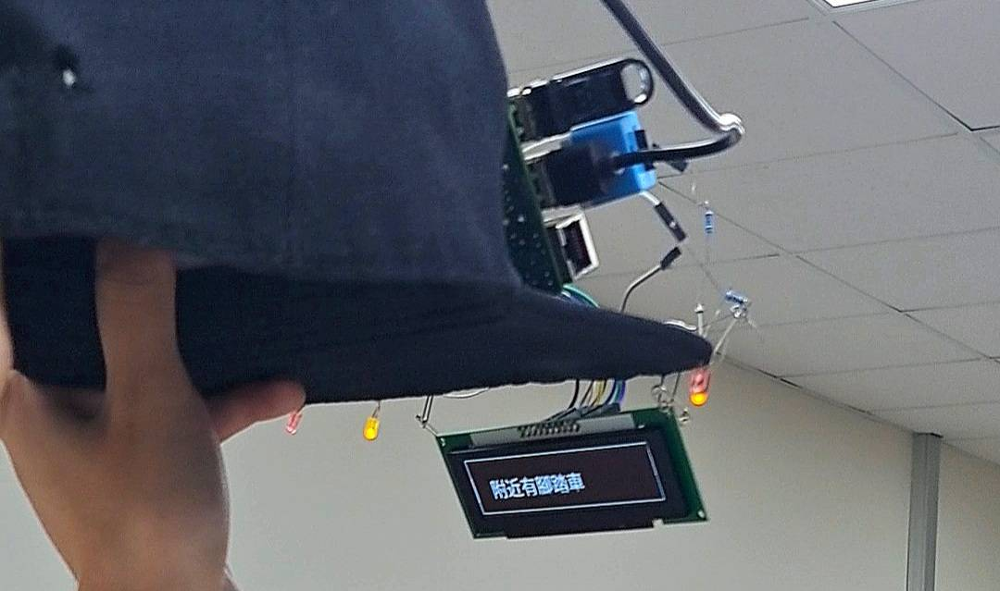

# Wireless AI Smart Hat for Hearing-Impaired Users

## 無線 AI 聽損智慧帽

Wireless AI Smart Hat is a Raspberry Pi-based wearable assistive system designed to convert important auditory information into visual information for hearing-impaired users.

The system integrates real-time speech recognition, hazardous environmental sound recognition, sound-source direction estimation, OLED display, and LED direction indicators. By processing audio directly on the Raspberry Pi, the system can operate without continuously transmitting audio to cloud services.

---

## Project Overview

Hearing-impaired users may encounter difficulties in understanding speech, noticing important environmental sounds, and identifying the direction of sound sources.

This project aims to reduce these information gaps by converting auditory information into visual feedback.

The system provides:

- Real-time speech subtitles
- Hazardous sound recognition
- Sound-source direction estimation
- OLED visual warnings
- LED direction indicators
- Edge AI processing on Raspberry Pi
- Offline operation

---

## System Architecture



The Raspberry Pi serves as the main edge-computing platform and integrates speech recognition, environmental sound recognition, sound-source direction estimation, and visual feedback modules.

---

## System Flowchart



The system continuously captures environmental audio through the microphone array.

Speech and environmental sounds are processed by different AI modules, while the sound-source direction is estimated simultaneously. The results are then converted into visual information and displayed through the OLED and LED indicators.

---

## Main Functions

### 1. Real-Time Speech Recognition

The system uses Whisper through whisper.cpp to convert spoken audio into real-time text subtitles.

The speech recognition module runs locally on the Raspberry Pi, reducing dependence on network connectivity and cloud services.

---

### 2. Hazardous Environmental Sound Recognition

YAMNet is used to classify environmental sounds.

The current system focuses on several important sound categories, including:

- Alarm / Siren
- Vehicle Horn
- Dog Bark
- Background Sound

When an important sound event is detected, the system generates a visual warning for the user.

---

### 3. Sound-Source Direction Estimation

The ReSpeaker USB microphone array is used to estimate the Direction of Arrival (DoA) of incoming sound.

The detected sound direction is converted into user-friendly direction information such as:

- Front
- Left
- Right

LED indicators are used to provide an intuitive direction cue.

---

### 4. OLED Visual Display

The SSD1322 OLED display provides visual information including:

- Speech subtitles
- Hazardous sound warnings
- Sound-source direction information

---

### 5. LED Direction Indicators

LED indicators provide additional visual feedback for sound direction.

When an important environmental sound is detected, the LED indicators show the approximate direction of the sound source.

---

## Hardware

The current prototype includes:

- Raspberry Pi 4B
- ReSpeaker USB Microphone Array
- SSD1322 OLED Display
- LED Indicators
- Portable Power Supply
- Wearable Hat Prototype

---

## Software and AI Models

### Whisper

Whisper is an automatic speech recognition model developed by OpenAI.

In this project, Whisper is used to convert spoken audio into text.

Official repository:

https://github.com/openai/whisper

---

### whisper.cpp

whisper.cpp is a lightweight C/C++ implementation of Whisper suitable for edge devices such as Raspberry Pi.

Official repository:

https://github.com/ggml-org/whisper.cpp

---

### YAMNet

YAMNet is an audio event classification model based on MobileNet and trained using AudioSet.

In this project, YAMNet is used for environmental sound recognition.

Official source:

https://www.tensorflow.org/hub/tutorials/yamnet

---

## Prototype



The AI modules, microphone array, OLED display, LEDs, and Raspberry Pi are integrated into a wearable smart-hat prototype.

---

## OLED Demonstration



The OLED display presents real-time speech subtitles and environmental warning information.

---

## LED Direction Demonstration



LED indicators provide visual cues corresponding to the estimated sound-source direction.

---

## Project Structure

```text
Wireless-AI-Smart-Hat/
├── docs/
│   ├── README.md
│   ├── led_direction_demo.jpg
│   ├── oled_demo.png
│   ├── prototype.jpg
│   ├── system_architecture.png
│   └── system_flowchart.jpg
│
├── src/
│   ├── Integrated_System/
│   │   ├── README.md
│   │   ├── vistra_main.py
│   │   ├── yamnet.tflite
│   │   └── yamnet_class_map.csv
│   │
│   └── YAMNet/
│       └── yamnet_fourclass_evaluation.py
│
├── .gitignore
├── LICENSE
├── README.md
└── requirements.txt